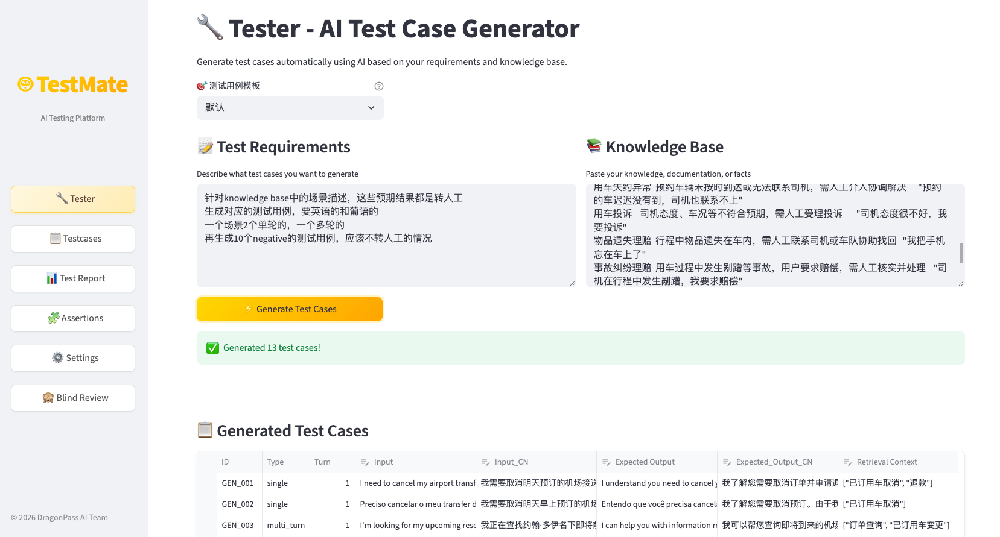
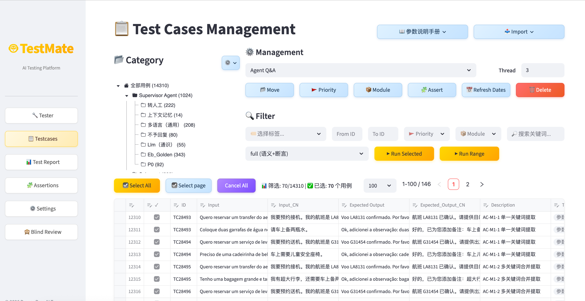
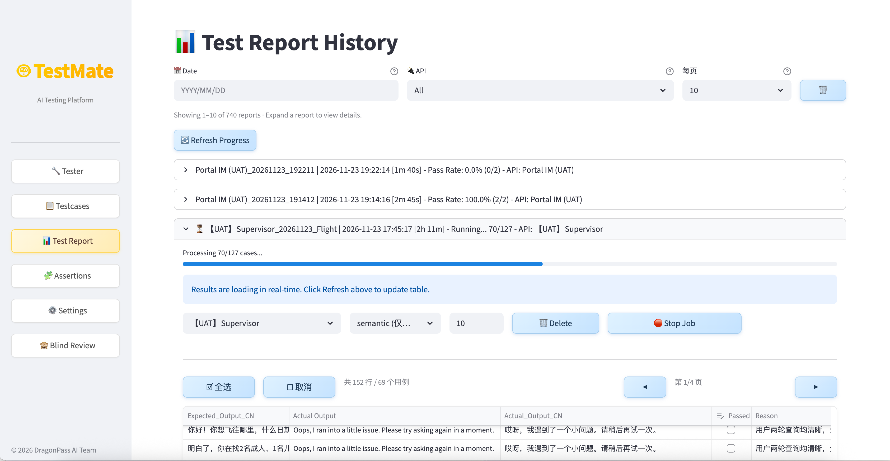
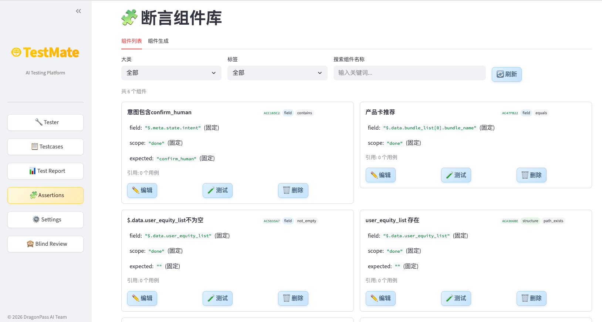
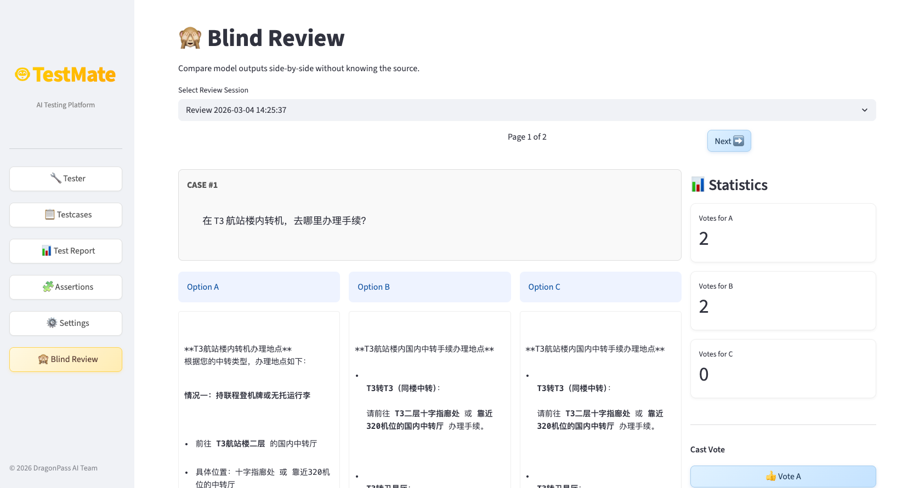

<div align="center">

# TestMate · AI Testing Platform

**面向 AI Agent / LLM 接口的全链路自动化测试平台**

*An end-to-end automated testing platform for AI agents and LLM APIs*

</div>

---

## 简介 · Overview

**中文**

TestMate 是一款专为 AI Agent 与 LLM 接口设计的全链路质量保障平台。传统接口测试工具（Postman / JMeter）面对大模型响应的**非确定性**与**流式 / 多模态**输出时无能为力，TestMate 采用 **「语义评分 + 结构化断言 + 多轮会话」** 三位一体的方案，覆盖用例管理、AI 生成、自动执行与评测的全流程，显著提升 AI 接口测试效率。

**English**

TestMate is an end-to-end quality assurance platform purpose-built for AI agents and LLM APIs. Conventional API testing tools (Postman / JMeter) fail to cope with the **non-deterministic** and **streaming / multimodal** responses of large-language models. TestMate combines **semantic scoring, structured assertions, and multi-turn conversation** to cover the full lifecycle of test-case management, AI generation, automated execution, and evaluation — dramatically improving AI API testing efficiency.

## 核心功能 · Core Features

- **测试用例管理 · Test Case Management** — 分类树 + 批量勾选 + 优先级 / 模块 / 标签筛选，支持单轮与多轮用例
- **AI 一键生成用例 · AI Test Case Generator** — 基于需求与知识库自动生成多语言测试用例
- **自动执行 · Automated Execution** — 后台异步并行执行，进度实时可见，不阻塞界面
- **测试报告 · Test Report** — 执行历史、通过率、耗时、逐条结果与失败原因
- **组件化断言 · Componentized Assertions** — JSONPath + scope 过滤 + 字段断言，一次定义多处复用
- **盲评 · Blind Review** — 多模型输出并排对比投票，进行无偏见评测

## 界面预览 · Screenshots

### AI 用例生成 · AI Test Case Generator



### 测试用例管理 · Test Case Management



### 测试报告 · Test Report



### 断言组件库 · Assertions



### 盲评 · Blind Review



## 快速开始 · Quick Start

```bash
pip install -r requirements.txt
streamlit run streamlit_app.py --server.port 8501
```

浏览器访问 `http://localhost:8501`。

## 部署 · Deployment

### Docker（推荐）

```bash
docker build -t testmate .
docker run -d -p 8501:8501 --name testmate-container testmate
```

### 直接部署

```bash
git clone <your-git-repo-url>
cd <repo-folder>
pip install -r requirements.txt
streamlit run streamlit_app.py --server.port 8501
```

使用 `nohup` 或 `systemd` 保持后台运行。

## 配置 · Configuration

- **API 配置**：编辑 `data/api_config.json` 管理接口端点、token 与请求参数
- **环境变量**：创建 `.env` 配置 API Key（如 `OPENAI_API_KEY`）