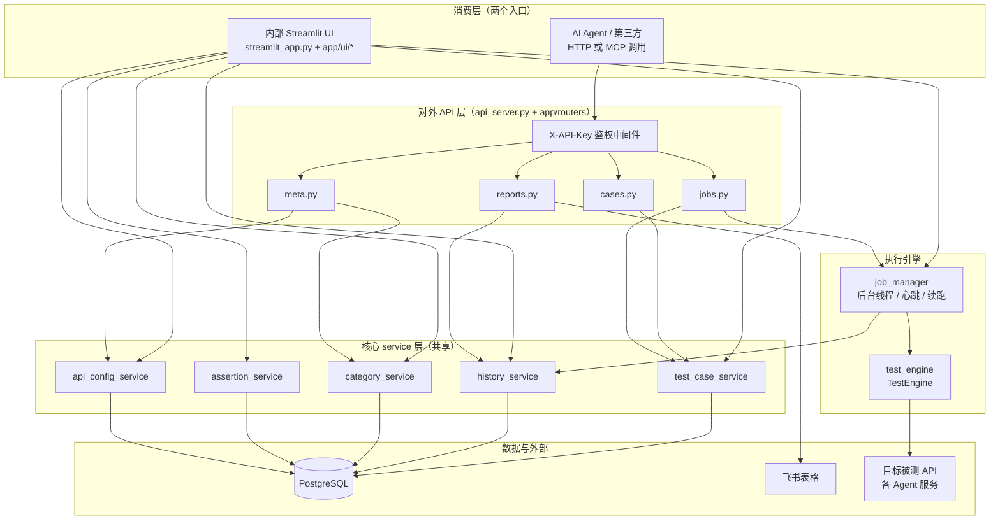

# 系统架构说明

Chatbot AI Tester 是一个 AI Agent 测试平台：编写/导入测试用例，对目标被测服务（各类 Agent API）批量执行，产出测试报告并可导出到飞书。

核心设计原则：**业务能力沉淀在唯一的 service 层，两个「消费方」（内部 Streamlit UI 与对外 HTTP API）共享这一层，互不干扰。**

---

## 1. 整体分层



---

## 2. 分层职责

### 消费层（两个入口，互不依赖）

| 入口 | 技术形态 | 说明 |
|------|----------|------|
| 内部 Streamlit UI | `streamlit_app.py` + `app/ui/*` | **进程内直接 import** service 层调用，不走 HTTP |
| 对外 HTTP API | `api_server.py` + `app/routers/*` | 独立的 FastAPI 应用，`/api/v1/*` 前缀，`X-API-Key` 鉴权 |

> 关键点：内部 UI 与对外 API 不是「UI 调 API」的关系，而是**两个平级的消费方**，各自直接复用 service 层，因此改对外接口不会影响 UI，反之亦然。

### 核心 service 层（唯一业务核心）

所有业务逻辑收敛在此，**只读复用、不随消费方变化**：

- `test_case_service.py` — 用例 CRUD / 批量 upsert（500/批）/ 分类·优先级·模块更新
- `history_service.py` — 测试报告（历史）与结果的读写
- `category_service.py` — 目录树构建 / 节点增删改移
- `assertion_service.py` — 断言组件管理
- `api_config_service.py` — 目标被测 API 的配置（name → url/type/token）

### 执行引擎

- `test_engine.py` — 真正向「目标被测 API」发请求、跑单条/批/多轮用例并判定结果
- `job_manager.py` — 单例后台调度：
  - `run_background_job` 触发后台线程执行
  - 心跳机制（每完成一条更新 `status`，防止跨进程误判中断）
  - `cancel_job` / `continue_job`（CAS 原子更新防并发重复执行）
  - 进度持久化（`total` 保留原始计划数，`started_count` 递增，`base_done` 偏移支持续跑显示）

### 数据与外部

- **PostgreSQL**：`test_cases` / `categories` / `test_history` / `test_results` / `assertions` / `api_configs` 等
- **目标被测 API**：各类 Agent 服务（Portal IM、Agent Q&A、Flight、Limo、Trip Planner 等，见 `.env` 及 api_configs 表）
- **飞书**：报告导出（`feishu_client.py`，支持多报告 → 一个/多个文档、新建 sheet / 追加 sheet）

---

## 3. 对外 API 目录

见同目录 [API.md](./API.md)。路由定义在 `app/routers/`：

| 文件 | 前缀 | 能力 |
|------|------|------|
| `app/routers/cases.py` | `/api/v1/cases` | 用例增删改查 / 导入 / 批量更新 |
| `app/routers/jobs.py` | `/api/v1/jobs` | 触发执行 / 进度 / 取消 / 续跑 |
| `app/routers/reports.py` | `/api/v1/reports` | 报告管理 / 导出飞书（单、批量） |
| `app/routers/meta.py` | `/api/v1` | 分类树 / API 配置 |

---

## 4. 关键目录速览

```
chatbot-ai-tester/
├── api_server.py            # 对外 API 入口（FastAPI + 鉴权 + include routers）
├── streamlit_app.py         # 内部 UI 入口
├── app/
│   ├── routers/             # 对外 API 路由（cases/jobs/reports/meta）
│   ├── ui/                  # Streamlit 页面（内部 UI，进程内调 service）
│   ├── services/            # 核心 service 层（共享，只读复用）
│   ├── test_engine.py       # 被测 API 请求与判定引擎
│   ├── job_manager.py       # 后台任务调度（心跳/续跑/取消）
│   ├── feishu_client.py     # 飞书导出
│   ├── models/              # ORM 模型
│   └── database.py          # SQLAlchemy engine / SessionLocal
├── .env                     # 环境变量（DATABASE_URL、API_KEY、API 配置等）
├── API.md                   # 对外接口文档
└── architecture.md          # 本文档
```

---

## 5. 设计约束（务必遵守）

1. **service 层只读复用**：对外接口直接 import service，不修改 service 的函数签名/行为，避免波及内部 UI。
2. **对外适配放 router 层**：如 `case_ids → 完整用例数据` 的加载，放在 `app/routers/jobs.py` 的 `_load_cases_by_ids`，不进 job_manager。
3. **鉴权只作用于对外路由**：内部 UI 进程内调用，天然不经 HTTP 中间件，无影响。
4. **执行必须走 job_manager**：对外「触发执行」用后台 Job 模型，禁止同步阻塞跑大批量。